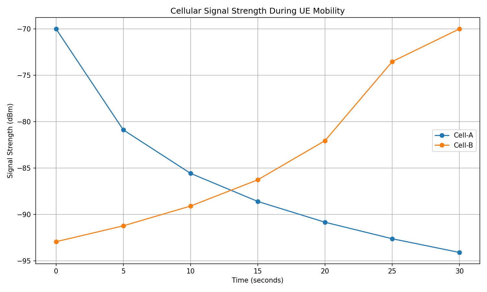

# 5G Cellular Handover Simulator

[](https://github.com/reddyvaishnavii/5g-cellular-handover-simulator/actions/workflows/ci.yml)

A C++17 simulator that models how a mobile device (UE) moves between cells and how the network decides when to hand it over. It combines signal strength, congestion, latency, packet loss and cell failures in one decision engine, and it is covered by automated tests and CI.



*Signal strength seen by a UE moving from Cell-A towards Cell-B. Cell-A fails at 15 s, so the UE is moved to Cell-B by emergency failover even though Cell-B is only ~2.3 dB stronger (below the 3 dB handover offset).*

## Features

- UE mobility across multiple cells
- Distance-based signal strength model
- Handover decision engine that works across **any number of cells**
- Signal advantage offset (A3-style) plus optional **time-to-trigger** to avoid reacting to short fluctuations
- Candidate health checks: utilization, latency, packet loss, availability
- Cell failure, **emergency failover** and recovery
- Every decision returns a **reason** (stay, waiting, handover, failover, no service), useful for logs, CSV and tests
- CSV export of every simulation step
- Python analysis and plotting
- CTest unit tests that also run in Release builds
- GitHub Actions CI

## How it works

Each simulation step, the `HandoverManager` receives the serving cell, the list of all cells and the UE, and returns a `HandoverDecision` (target cell + reason).

```
 UE position ──► Cell metrics (signal, latency, loss, utilization, availability)
                         │
                         ▼
                 HandoverManager::decide()
                         │
        ┌────────────────┼──────────────────┐
        ▼                ▼                  ▼
  Serving cell DOWN   Healthy neighbour   No advantage
  → emergency         stronger than       → stay
    failover          serving + offset
                      → (wait TTT) → handover
```

### Decision rules

1. **Serving cell is down** → emergency failover to the strongest *healthy* cell. If no healthy cell exists, a degraded but alive cell is accepted (better than a dead one). If nothing is reachable, the result is `NoServiceAvailable`.
2. **Serving cell is up** → find the strongest *healthy* neighbour. A neighbour is healthy if it is available and its utilization, latency and packet loss are within the configured limits.
3. The neighbour must be stronger than the serving cell by at least the **signal offset** (default 3 dB).
4. If **time-to-trigger** is set, that advantage must hold continuously for the whole TTT window. If it disappears, the timer restarts.

| Reason | Meaning |
|---|---|
| `StayBestAvailable` | Serving cell is fine, no neighbour is better by enough |
| `WaitingTimeToTrigger` | A neighbour is better, but not for long enough yet |
| `SignalHandover` | Neighbour held its advantage for the full TTT window |
| `EmergencyFailover` | Serving cell is down, moved to the best reachable cell |
| `NoServiceAvailable` | Serving cell is down and nothing can take the UE |

### Signal model

`signal_dBm = base_dBm − 20 · log10(distance)`

Simple on purpose, so decision logic can be tested deterministically. Replacing it with a log-distance model plus shadowing is on the roadmap.

### Parameters

```cpp
HandoverManager manager(
    3.0,    // signal offset (dB): neighbour must be this much stronger
    0.80,   // max candidate utilization
    30.0,   // max candidate latency (ms)
    0.05,   // max candidate packet loss (5%)
    0.0,    // optional: time-to-trigger in seconds (0 = off)
    -200.0  // optional: ignore cells weaker than this (dBm)
);
```

## Project structure

```
cpp/
  include/    Cell.h, UserEquipment.h, HandoverManager.h
  src/        Cell.cpp, UserEquipment.cpp, HandoverManager.cpp, main.cpp
  CMakeLists.txt
tests/        test_handover.cpp
python/       analyze_simulation.py, plot_results.py
data/         simulation_results.csv (generated)
results/      signal_strength.png (generated)
.github/workflows/   CI
```

## Build and run

Requirements: a C++17 compiler (GCC, Clang or AppleClang), CMake, and Python 3 with `pandas` and `matplotlib` for the plots.

```bash
# configure + build (from the repo root)
cmake -S cpp -B build -DCMAKE_BUILD_TYPE=Debug
cmake --build build

# run the tests
ctest --test-dir build --output-on-failure

# run the simulation (from build/, because the default CSV path is ../data/)
cd build
./cellular_simulator
# or choose where the CSV goes:
./cellular_simulator ../data/my_run.csv
cd ..

# generate the plot
pip3 install pandas matplotlib
python3 python/plot_results.py
```

### Sample scenario

Two cells 150 units apart. The UE starts near Cell-A and moves towards Cell-B at 5 units/s. Cell-B is 50% utilized. Cell-A fails at 15 s and recovers at 25 s.

```
t=0..10   STAY      Cell-A  (Cell-A is still the stronger cell)
t=15      Cell-A fails → HANDOVER (EmergencyFailover): Cell-A -> Cell-B
t=20..30  STAY      Cell-B  (Cell-A recovered at 25 s, but Cell-B is far stronger)
```

### CSV columns

`time, serving_cell, cell_a_signal, cell_b_signal, cell_a_utilization, cell_b_utilization, cell_a_latency, cell_b_latency, cell_a_packet_loss, cell_b_packet_loss, decision_reason`

## Testing

The test suite (`tests/test_handover.cpp`) has 11 test cases:

- Healthy stronger neighbour triggers a handover
- Overloaded, high-latency, lossy and unavailable candidates are rejected
- Equal signal does not trigger a handover
- Failover when the serving cell fails
- No service when every cell is down
- Failover accepts a degraded cell if nothing healthy exists
- Failover prefers a healthy cell over a stronger but congested one
- Picks the strongest eligible cell out of several
- Time-to-trigger waits, then hands over
- Time-to-trigger restarts when the advantage disappears
- Minimum signal floor excludes weak cells

Tests use a custom `CHECK` macro instead of `assert`, so they still run in Release builds (`-DNDEBUG`) instead of being silently compiled out.

## Limitations and roadmap

Current limitations: signal model is deterministic (no shadowing or fading), latency / loss / utilization are fixed per cell, and the demo uses a single UE.

Planned:

- [ ] Plot markers for failure, recovery and handover events
- [ ] Baseline "strongest signal only" policy and a comparison table (handover count, ping-pong rate, outage time)
- [ ] Multiple UEs competing for cell capacity, with ping-pong detection
- [ ] Latency and packet loss that grow with cell utilization
- [ ] Log-distance path loss with seeded random shadowing
- [ ] Scenario configuration from a JSON/YAML file
